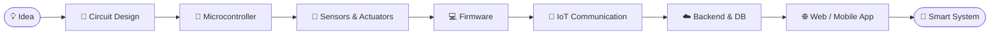

 

  

## 👨‍💻 About Me 

<table>
<tr>
<td width="62%" valign="top">

I'm an **Embedded Engineer** and **Robotics & IoT Developer** who builds practical systems connecting **hardware, firmware, software, and intelligent automation**.

I work with microcontrollers, sensors, motors, communication modules, IoT platforms, web applications, and AI/ML systems, turning ideas into working prototypes and reliable real-world solutions.

> **Mindset:** Learn → Build → Test → Improve

</td>
<td width="38%" valign="top">

| | |
|---|---|
| 🎯 **Role** | Embedded Engineer |
| 🤖 **Domain** | Robotics · IoT · Automation |
| 🧠 **Also** | Full-Stack · AI/ML |
| 📍 **Location** | India |

</td>
</tr>
</table>

## 🛠️ Tech Stack

**🔌 Embedded & Hardware**

**💻 Languages**

**🌐 Web & Backend**

**🗄️ Databases & Cloud**

**📡 IoT & Communication**

**🧰 Tools**

## 🤖 Featured Projects

<table>
<tr>
<td width="50%" valign="top">

### 🚜 Smart Drainage Monitoring Rover
IoT-enabled robotic rover for drainage inspection and monitoring.

- Manual and autonomous movement
- Bluetooth control + ESP32-CAM live view
- Ultrasonic obstacle detection
- Auto headlights and reverse warning
- Camera servo control

`Arduino UNO` `L293D` `ESP32-CAM` `Ultrasonic` `Servo` `Bluetooth`

</td>
<td width="50%" valign="top">

### 🏠 Nextronix IoT Platform
Smart platform to control and monitor connected devices from a web dashboard.

- Real-time device control over MQTT
- Device status monitoring
- Web dashboard with MongoDB storage
- ESP32-based device nodes

`ESP32` `MQTT` `HiveMQ` `React.js` `Node.js` `MongoDB`

</td>
</tr>
<tr>
<td width="50%" valign="top">

### 🏨 Hotel Reservation Booking System
Full-stack web app for managing hotels, rooms, users, reservations, and booking information.

`React.js` `Node.js` `Express.js` `MongoDB`

</td>
<td width="50%" valign="top">

### 🚗 Accident Risk Prediction
Machine-learning web application that predicts accident risk from input parameters via a REST API.

`Python` `Flask` `Scikit-learn` `REST API`

</td>
</tr>
<tr>
<td colspan="2" valign="top">

### 📱 Robotics Control Application
Android app that controls robotic systems wirelessly: Bluetooth connectivity, robot movement, light control, camera servo control, and Manual / Auto modes.

`Android` `Java` `Bluetooth` `Arduino`

</td>
</tr>
</table>

## 🔬 Engineering Workflow

I work across the full development cycle: electronics, firmware, cloud services, and user-facing applications.

## 🎯 Current Focus

<table>
<tr>
<td width="25%" valign="top">

**📚 Learning**
- STM32
- Embedded C/C++
- Advanced IoT
- Robotics

</td>
<td width="25%" valign="top">

**🔨 Building**
- Smart IoT devices
- Robotics projects
- Embedded applications
- IoT web platforms

</td>
<td width="25%" valign="top">

**🔭 Exploring**
- Edge AI
- AI + Embedded
- Automation
- Connected devices

</td>
<td width="25%" valign="top">

**🏁 Goal**
- Reliable embedded products
- Practical real-world tech
- Continuous improvement

</td>
</tr>
</table>

## 📊 GitHub Stats

 

  

## 📫 Let's Connect

 

  

*"Ideas become innovation when you build them."* ⚡

